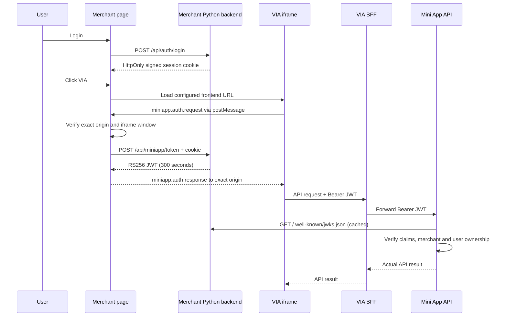
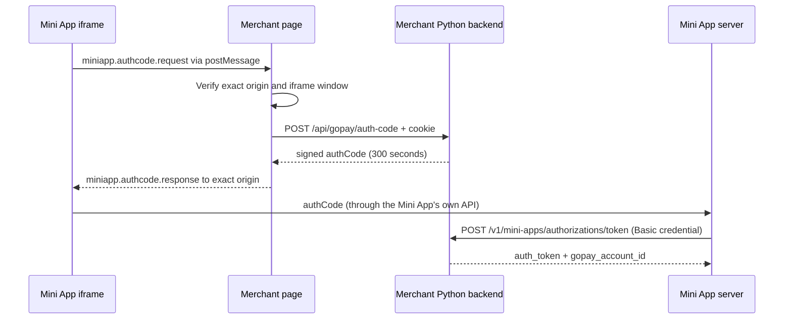

# Architecture and responsibilities

## Roles

| Component | Responsibility |
| --- | --- |
| Merchant simulator backend | Login its repository fixture demo users, issue signed session cookies, mint short-lived Mini App JWTs, publish public JWKS. |
| Merchant page | Display the launcher, host the configured iframe, validate bridge messages, retrieve JWT using the merchant session. |
| VIA Mini App frontend (separate team) | Render PPOB UI, request JWT through the SDK, keep token in memory, call its own backend/BFF. |
| Mini App BFF (separate team) | Accept bearer token from FE and forward it to the configured Mini App service; never turn unverified claims into trusted identity. |
| bevia-miniapp-service | Verify merchant JWT using registered JWKS, enforce merchant/user ownership, orchestrate Product/Order/PG integrations. |

The simulator does not implement products, inquiry, checkout, payment reconciliation, user registration, balances, or the Mini App BFF. No Go service is modified.

## Sequence

## GoPay-like auth_code sequence

An additional mode mimics the host-side shape of the GoPay/Midtrans "User Authentication" flow (`getAuthCode` in the Mini App, then a server-to-server exchange). The JWT sequence above is unchanged and independent.

The code and the auth token are stateless `itsdangerous` values signed with `SESSION_SECRET`, each under its own salt (`gopay-auth-code-v1`, `gopay-auth-token-v1`), so the login cookie, an auth code and an auth token are not interchangeable. The code carries the stable user ID and its issue time and is accepted for 300 seconds. The auth token carries the user ID and has no expiry, like the provider's. The simulator keeps no state, so a code can be exchanged more than once within its lifetime (no single-use guarantee) and neither value can be revoked individually; rotating `SESSION_SECRET` invalidates all of them, and all sessions. The exchange endpoint is for servers: it has no CORS policy and is protected only by the shared Basic credential.

## Boundaries

The native GoPay seamless-login SDK is not used. The browser iframe and postMessage interface simulate the container interaction; they are not GoPay protocol compatibility. The auth_code mode follows the documented Midtrans contract in shape only; the real provider's behavior, error catalogue, rate limits and token semantics were not tested. Real GoPay integration requires onboarding and its own SDK. See official [container](https://docs.midtrans.com/reference/migration-guides) and [seamless login](https://docs.midtrans.com/reference/seamless-login-v2) documentation.

A signed session is stateless and expires after eight hours. Logout removes the browser cookie; it does not revoke copied cookies or previously minted JWTs. JWTs expire after five minutes. There is no central revocation store. The backend configuration and deployed fixture revision must stay identical across instances. Ten synthetic user profiles live in `fixtures/demo_users.json`; their shared login password is read exclusively from the server environment `DEMO_USER_PASSWORD`. The fixture contains no password material.
