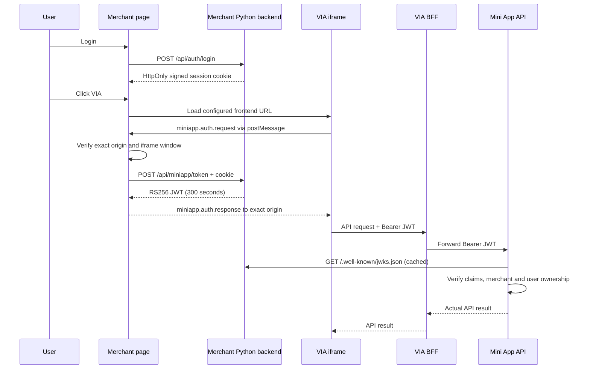

# Architecture and responsibilities

## Roles

| Component | Responsibility |
| --- | --- |
| Merchant simulator backend | Login its repository fixture demo users, issue signed session cookies, mint short-lived Mini App JWTs, publish public JWKS. |
| Merchant page | Display the launcher, host the configured iframe, validate bridge messages, retrieve JWT using the merchant session. |
| VIA Mini App frontend (separate team) | Render PPOB UI, request JWT through the SDK, keep token in memory, call its own backend/BFF. |
| Mini App BFF (separate team) | Accept bearer token from FE and forward it to the configured Mini App service; never turn unverified claims into trusted identity. |
| bevia-miniapp-service | Verify merchant JWT using registered JWKS, enforce merchant/user ownership, orchestrate Product/Order/PG integrations. |

The simulator does not implement products, inquiry, checkout, payment reconciliation, user registration, balances, or the Mini App BFF. No Go service is modified.

## Sequence

## Boundaries

The native GoPay seamless-login SDK is not used. The browser iframe and postMessage interface simulate the container interaction; they are not GoPay protocol compatibility. Real GoPay integration requires onboarding and its own SDK. See official [container](https://docs.midtrans.com/reference/migration-guides) and [seamless login](https://docs.midtrans.com/reference/seamless-login-v2) documentation.

A signed session is stateless and expires after eight hours. Logout removes the browser cookie; it does not revoke copied cookies or previously minted JWTs. JWTs expire after five minutes. There is no central revocation store. The backend configuration and deployed fixture revision must stay identical across instances. Ten public synthetic accounts live in `fixtures/demo_users.json`; no account environment variable is used.
